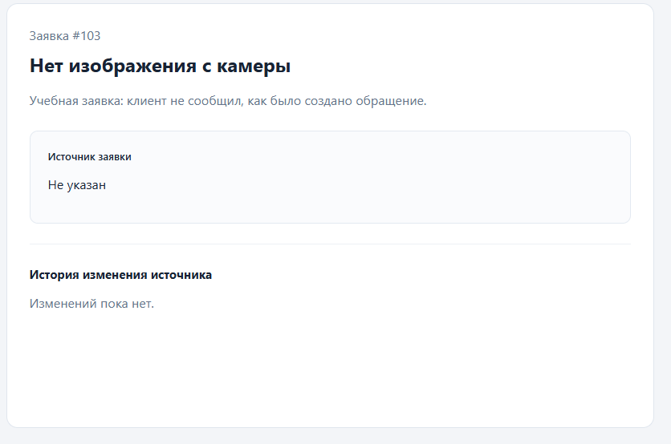

# Решение

## Затраченное время

Время разработки и отдельно время настройки окружения:
Минут 5-6, не более.

## Найденные причины

Для каждой проблемы: воспроизведение → причина → исправление → проверка.

---
Активный тикет с ID 103 показывает, что источник не был найден.

Воспроизвел при переходе на тикет с ID 103.

Причина была в том что ID источника нет в таблице sources.

Ниже приведен лог который выдавал ошибочный тикет.

```
[2026-10-13 12:28:04] Array
(
    [0] => Array
        (
            [id] => 103
            [title] => Нет изображения с камеры
            [description] => Учебная заявка: клиент не сообщил, как было создано обращение.
            [status] => active
            [source_id] => 
            [updated_at] => 2026-10-13 12:13:05.725264+00
        )

    [1] => 
)

```

Исправление:

В классе ``TicketRepository`` нашел метод ``find``. При помощи метода ``dumpLog`` нашел, что переменная ``$source`` выдает ``null``. Добавил доп проверку, что если ``$source`` пустой, то присваеваем следующий массив: 

```php
if(!$source) {
    $source = array(
        'id' => -1,
        'name' => 'Не указан'
    );
}
```

Проверка:

Воспроизвожу такую же ошибку как при первой проверки.
По итогу источник заявок показывает как "Не указан".



---

Человек который имеет доступ только к просмотру тикетов имеет право изменять тикет.

Для проверки я зашел от пользователя у которого есть право просмотра записей. 

Взяв curl и переведя его в php код, я, через пользователя у которого есть право только для просмотра заявок (тикетов), увидел, что он имеет право изменять источник заявки.

Решение:

В `backend\src\routes.php` добавил проверку в метод `/api/tickets/<id заявки>/source` на `POST` запрос.

Если у пользователя нет прав на редактирование `FUNC_TICKETS_SOURCE_EDIT`, то тогда выдаем `403` ошибку и выводим ответ.

Пример ниже:

```
HTTP код: 403
Ответ сервера:
{"error":"forbidden","message":"Недостаточно прав"}
```

Для проверки я использовал тот же самый php скрипт, а также проверил, что от пользователя с правами редактировать заявки работает изменение источника.

---

Воспроизвел ошибку, что пользователь с правом редактировать карточки заявок имеет возможность редактировать архивные карточки.

Воспроизвел ошибку при помощи скрипта test.php.

Решение:

Зашел в класс `TicketRepository` и отыскал метод `changeSource`. Добавил в SQL запрос, чтобы тот отдавал статус заявки.
Затем добавил проверку, что если статус заявки равен архивной заявки, то отдавать `403` ошибку.

Для проверки использовал скрипт test.php для того чтобы проверить, что архивная заявка больше не изменяеться.

От имени редактора посмотрел, что заявки которые не имеют статус архивированные - могут изменяться.

---

Ошибка с быстрым пререключением карточки заявок отдает иногда предыдущию заявку.

Связанна данная ситуация с тем что предыдущая заявка не успевает прогрузиться и из-за этого заменяет текущию заявку.

Решение:

В `TicketPanel.jsx` изменил код, что если пользователь быстро переключаеться на предыдущию заявку, то отменяем ожидания ответа от предыдущей заявки и сразу грузим новую.

Проверил при помощи быстрого переключения с одной заявки на другую.

---


## Решения и компромиссы

Почему выбран такой подход? Какие альтернативы рассмотрены?

Я выбрал стандартный подход. Просто использовал, что уже есть в проекте и не придумывать что-то новое.

Альтернативы никакие не рассматривал.

## Запуск проверок

Команды и фактические результаты:

```
Command:
python3 tools/smoke.py http://localhost:5173

Result:
PASS: PHP 7.4, isolated database, session, list, sources, normal ticket
```

```
```

## Одновременное редактирование

Что произойдёт при изменении одной заявки двумя сотрудниками?

Если первый сотрудник изменил, например, 102 заявку, а затем второй сотрудник изменил ту же самую заявку, то применяться изменнения второго сотрудника.

## Оставшиеся ограничения

Что не закончено и что сделали бы следующим?

Вроде как все было закончено.
